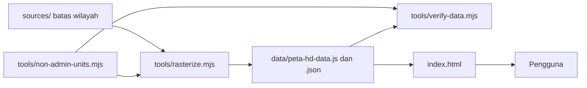

# Blueprint: Peta Pixel Nusantara

## Ringkasan

Peta Pixel Nusantara adalah peta Indonesia 8bit open-source. Repo ini berisi data grid pixel untuk 38 provinsi dan 514 unit kabupaten/kota, plus demo interaktif.
Pengembang web, game, dan dashboard memakainya sebagai peta pixel yang tajam tanpa tile server. Rama Aditya membuat peta ini untuk aiclub.id.

## Status proyek

| Hal | Nilai |
|-----|-------|
| Tahap | Produksi sebagai repo open-source. Rilis awal ada di commit `291583e`. |
| URL produksi | TBD: lihat bagian "Pertanyaan terbuka". |
| URL staging | Belum ada. |
| Repo | `RamaAditya49/peta-pixel-nusantara`, publik, lisensi kode MIT. |

## Peta sistem

## Stack

| Lapisan | Teknologi | Catatan |
|---------|-----------|---------|
| Demo | HTML, CSS, JavaScript vanilla, Canvas 2D | Tanpa framework, bundler, atau backend. |
| Tools data | Node.js, modul ES (`.mjs`) | Tanpa package manager. Repo tidak punya `package.json`. |
| Format data | JSON plus grid RLE | Dimuat lewat `window.PETA_HD`. |
| Font demo | Google Fonts (CDN) | Tanpa CDN, demo memakai font sistem. |
| Hosting | TBD | Lihat "Pertanyaan terbuka". |

## Struktur repo

| Path | Isi |
|------|-----|
| `index.html` | Demo interaktif dan renderer. |
| `data/peta-hd-data.js` | Data hasil generate untuk browser (`window.PETA_HD`). |
| `data/peta-hd-data.json` | Data hasil generate dalam JSON murni. |
| `sources/` | Batas wilayah sumber: provinsi (TopoJSON), kab/kota (GeoJSON), fallback lama (TopoJSON). |
| `tools/rasterize.mjs` | Ubah batas wilayah menjadi grid pixel. |
| `tools/non-admin-units.mjs` | Daftar fitur non-administratif. Rasterizer dan verifier memakainya bersama. |
| `tools/verify-data.mjs` | Cek kontrak data hasil generate. |
| `assets/` | `favicon.svg` dan `preview.png`. |
| `internal/` | Dokumentasi kerja. |
| `README.md`, `AGENTS.md`, `CLAUDE.md`, `CONTRIBUTING.md`, `ATTRIBUTION.md`, `CITATION.cff`, `LICENSE` | Dokumen publik dan aturan agent. |

## Alur data

1. Rasterizer membaca `sources/indonesia-38-provinces.topo.json` untuk provinsi.
2. Rasterizer membaca `sources/geoBoundaries-IDN-ADM2_simplified.geojson` untuk kab/kota. Kalau berkas ini tidak ada, rasterizer memakai `sources/indonesia-topojson-city-regency.json`.
3. Rasterizer memisahkan fitur non-administratif. Empat danau/waduk masuk `waterRle`. Fitur "Hutan" dibuang.
4. Rasterizer mengisi grid provinsi dan kab/kota dengan scanline fill pada bounds yang sama.
5. Rasterizer menetapkan provinsi induk tiap kab/kota lewat majority vote geografis.
6. Rasterizer menulis `data/peta-hd-data.js` dan `data/peta-hd-data.json`.
7. `index.html` membaca `window.PETA_HD` dan menggambar peta di canvas.

## Lingkungan dan deploy

| Lingkungan | URL | Host | Cara deploy |
|------------|-----|------|-------------|
| Demo lokal | `http://localhost:8080` | Mesin pengembang | `python3 -m http.server 8080` |
| Produksi | TBD | TBD | TBD |

Repo tidak punya konfigurasi deploy, CI, atau berkas hosting.

## Perintah penting

| Tujuan | Perintah | Jalan di |
|--------|----------|----------|
| Cek sintaks rasterizer | `node --check tools/rasterize.mjs` | `rama-tuf` |
| Cek sintaks verifier | `node --check tools/verify-data.mjs` | `rama-tuf` |
| Generate data | `node tools/rasterize.mjs [lebarGrid]` | `rama-tuf` |
| Verifikasi data | `node tools/verify-data.mjs` | `rama-tuf` |
| Lint Markdown | `npx --yes markdownlint-cli2 README.md ATTRIBUTION.md AGENTS.md CLAUDE.md CONTRIBUTING.md` | `rama-tuf` |
| Cek whitespace | `git diff --check` | Mesin ini |
| Lihat demo | `python3 -m http.server 8080` | `rama-tuf` |

Aturan Rama mewajibkan build, test, dan server berjalan di `rama-tuf`. Lebar grid bawaan 1600. Rasterizer menerima 100 sampai 10000.

## Integrasi luar

| Layanan | Untuk apa | Lokasi kredensial (tanpa nilai) |
|---------|-----------|---------------------------------|
| Google Fonts | Font demo (Press Start 2P, VT323, Space Grotesk) | Tidak perlu kredensial. |
| geoBoundaries, denyherianto, tvalentius | Sumber batas wilayah, disalin ke `sources/` | Tidak perlu kredensial. |

## Pertanyaan terbuka

- TBD: Apakah demo punya URL publik? Kalau ya, di host mana dan bagaimana cara deploy-nya?
- TBD: Isu closed #3 (CI), #9 (test rasterizer), dan #56 (ESLint) tidak punya berkas di repo. Apakah fitur itu ditarik kembali?

## Sumber fakta

- `README.md`, `AGENTS.md`, `CLAUDE.md`, `CONTRIBUTING.md`, `ATTRIBUTION.md`, `CITATION.cff`
- `tools/rasterize.mjs`, `tools/verify-data.mjs`, `tools/non-admin-units.mjs`, `index.html`
- `git log --oneline -30` dan `git remote -v`
- `gh issue list` dan `gh pr list` (dibaca 2026-11-12)
