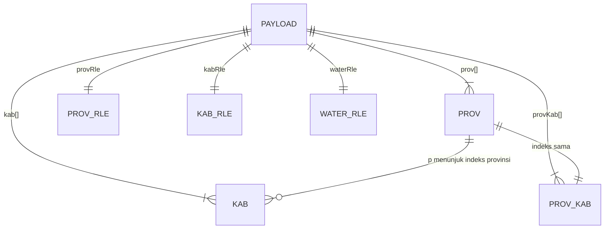

# ERD: Peta Pixel Nusantara

## Penyimpanan data

| Penyimpanan | Teknologi | Lokasi | Isi |
|-------------|-----------|--------|-----|
| Tidak ada database | Berkas statis | `data/peta-hd-data.json` | Payload peta dalam JSON |
| Payload untuk browser | JavaScript | `data/peta-hd-data.js` | Payload yang sama, ditetapkan ke `window.PETA_HD` |
| Sumber provinsi | TopoJSON | `sources/indonesia-38-provinces.topo.json` | Batas 38 provinsi |
| Sumber kab/kota | GeoJSON | `sources/geoBoundaries-IDN-ADM2_simplified.geojson` | 519 fitur ADM2, termasuk 5 fitur non-administratif |
| Sumber fallback | TopoJSON | `sources/indonesia-topojson-city-regency.json` | 388 unit kab/kota (GADM) |

Proyek tidak memakai database. Rasterizer membuat dua berkas data dari `sources/`. Jangan ubah berkas data dengan tangan.

## Diagram

## Entitas

### PAYLOAD (objek akar)

| Field | Tipe | Wajib | Catatan |
|-------|------|-------|---------|
| `W` | integer | ya | Lebar grid. Bawaan 1600. |
| `H` | integer | ya | Tinggi grid, dihitung dari rasio bounds. Bawaan 594. |
| `lonMin` | number | ya | Batas barat (WGS84). |
| `lonMax` | number | ya | Batas timur. |
| `latMin` | number | ya | Batas selatan. |
| `latMax` | number | ya | Batas utara. |
| `prov` | array of PROV | ya | 38 elemen. Indeks array adalah ID provinsi. |
| `kab` | array of KAB | ya | 514 elemen. Indeks array adalah ID kab/kota. |
| `provKab` | array of array of integer | ya | Satu daftar indeks `kab[]` per provinsi. |
| `provRle` | array of integer | ya | Grid provinsi, pasangan nilai/jumlah. `255` berarti laut. |
| `kabRle` | array of integer | ya | Grid kab/kota, pasangan nilai/jumlah. `65535` berarti laut. |
| `waterRle` | array of integer | ya | Grid air, pasangan nilai/jumlah. `1` berarti danau atau waduk. |

### PROV

| Field | Tipe | Wajib | Catatan |
|-------|------|-------|---------|
| `n` | string | ya | Nama provinsi. |
| `m` | number | ya | Metrik untuk pewarnaan. Rasterizer mengisi 0. |
| `a` | integer | ya | Luas dalam sel. Harus sama dengan jumlah sel di `provRle`. |
| `x0`, `y0`, `x1`, `y1` | integer | ya | Kotak batas dalam sel. |
| `cx`, `cy` | integer | ya | Titik pusat dalam sel. Harus berada di dalam kotak batas. |

### KAB

| Field | Tipe | Wajib | Catatan |
|-------|------|-------|---------|
| `c` | string | ya | Kode ADM2 unik (`shapeID` geoBoundaries). Kunci stabil. |
| `n` | string | ya | Nama. Awalan "Kota" dibuang untuk unit Kota. |
| `t` | string | ya | `Kabupaten` atau `Kota`. |
| `p` | integer | ya | FK: indeks provinsi induk di `prov[]`. |
| `a` | integer | ya | Luas dalam sel. Harus sama dengan jumlah sel di `kabRle`. |
| `x0`, `y0`, `x1`, `y1` | integer | ya | Kotak batas dalam sel. |
| `cx`, `cy` | integer | ya | Titik pusat dalam sel. |

## Indeks dan constraint

- `kab[].c` unik.
- `kab[].p` berada di rentang 0 sampai 37 dan tidak sama dengan 255.
- `provKab` punya 38 entri. Tiap indeks `kab[]` muncul tepat satu kali, di bawah provinsi induknya.
- Panjang `provRle`, `kabRle`, dan `waterRle` (jumlah semua count) sama dengan `W * H`.
- Nilai di `kabRle` kurang dari 514, atau 65535 untuk laut. Nilai di `provRle` kurang dari 38, atau 255 untuk laut.
- Verifier menegakkan aturan ini: `tools/verify-data.mjs`.

## Migrasi

- Lokasi migrasi: Tidak ada.
- Cara menjalankan: `node tools/rasterize.mjs` membuat ulang seluruh payload dari `sources/`.

## Data pribadi dan retensi

Tidak ada PII. Payload hanya memuat batas wilayah dan metrik agregat.

## Pertanyaan terbuka

- TBD: Perlukah schema payload mendapat nomor versi untuk konsumen luar?

## Sumber fakta

- `tools/rasterize.mjs` (objek `payload`, fungsi `rle`)
- `tools/verify-data.mjs`
- `README.md`, bagian "Data Format"
